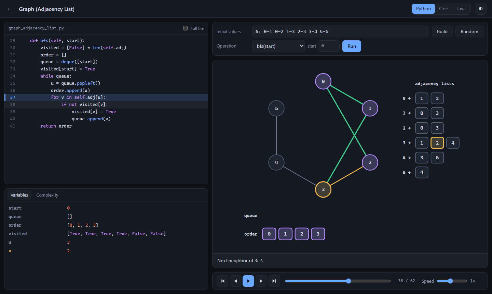

# Data Structure Visualizer

**29 data structures and graph algorithms, each implemented in Python, C++ and Java, with an interactive page that runs the code
step by step next to an animated picture of memory.**



## Features

- **Code and picture side by side.** The line being executed is highlighted, and the previous line is shaded.
- **Switch languages at any time.** Python, C++ or Java: the highlight jumps to the same step in the other language,
  and the animation stays where it is.
- **Full playback control.** Step forward and back, play or pause, 0.25× to 4× speed, a scrubber, and keyboard
  shortcuts (`←` `→` `Space` `Home` `End`).
- **Your own data.** Type initial values (or press Random), pick an operation and its arguments, and press Run.
- **See inside the algorithm.** A variables panel shows the locals at every step (`None` / `nullptr` / `null` per
  language), a plain-English caption explains each step, and a Complexity tab gives Big-O tables and notes.
- **Real, tested code.** The code on screen is the code in `src/`. It compiles, runs, and is covered by tests in
  every language, most of them randomized against the standard library.
- **No setup.** Plain HTML, CSS and JS with no dependencies. It works offline, straight from `file://`.
  Dark theme by default, with a light theme toggle.

## Quick start

```sh
git clone https://github.com/ArianArsenal/Data-Structure.git
```

Open `site/index.html` in any modern browser and pick a structure. Nothing to install.

## Structures

| Structure | Operations you can step through |
| --- | --- |
| **Linear** | |
| Static array | insert (shifting right), delete (shifting left), search |
| Dynamic array | append (grows by doubling), pop (shrinks at ¼ full) |
| Singly linked list | insert at head / tail / index, delete, search, reverse |
| Doubly linked list | insert at head / tail, delete |
| Circular linked list | insert at head / tail, delete, traverse |
| Stack | push, pop, peek |
| Queue (circular buffer) | enqueue, dequeue, drawn as a ring to show wrap-around |
| Deque (circular buffer) | push / pop at both ends |
| Skip list | search, insert with random tower heights |
| **Hashing** | |
| Hash table, separate chaining | put (doubles and rehashes when size > capacity), get, remove |
| Hash table, open addressing | put, get, remove (linear probing, tombstones) |
| Bloom filter | add, might_contain (shows false positives) |
| LRU cache | get, put with eviction (hash map plus doubly linked list) |
| **Trees** | |
| Binary search tree | insert, search, delete (all three cases), in-order traversal, minimum, maximum, successor |
| AVL tree | insert and delete with LL / RR / LR / RL rotations; node heights shown |
| Red-black tree | insert and delete (all fix-up cases) with recoloring and rotations |
| Splay tree | search, insert (zig, zig-zig, zig-zag) |
| B-tree (2-3-4) | search, insert with proactive splits, delete with borrowing and merging |
| Trie | insert, search, starts_with |
| **Heaps and range queries** | |
| Binary heap (min) | insert (sift up), extract_min (sift down), build_heap in O(n); shown as a tree and an array |
| Priority queue (max) | push, pop, peek |
| Segment tree | range-sum query, point update |
| Fenwick tree | update, prefix_sum (ranges and indexes in binary shown) |
| **Sets and strings** | |
| Union-find | find with path compression, union by rank |
| Suffix array | build (with LCP array), binary search for a pattern |
| **Graphs** | |
| Graph, adjacency list | add / remove edge, BFS, DFS |
| Graph, adjacency matrix | add / remove edge, BFS, DFS |
| Weighted graph | Dijkstra's shortest paths (priority queue), Kruskal's minimum spanning tree |
| Directed graph | add edge, topological sort (Kahn's algorithm), cycle detection (three-color DFS) |

### Input formats

Most pages take a list of integers, such as `5, 3, 8` or `5 3 8`. A few take other forms:

| Page | Example input |
| --- | --- |
| Trie | `car, cart, cat, dog` |
| Suffix array | `banana` |
| Union-find | `8: 0-1, 2-3` (8 elements, then optional unions) |
| Graphs | `6: 0-1 0-2 1-3` (6 vertices, then the edges; for the directed graph `a-b` means a → b) |
| Weighted graph | `5: 0-1:4 0-2:1 1-2:2` (edges with weights 1-99) |
| Hash tables, LRU cache | keys; each initial key `k` gets the value `k × 10` |

## How it works

Every operation is implemented twice: once as real code in each language, and once in JavaScript as a tracer that
records a frame per step (a snapshot of the structure, the local variables and a caption). The two are tied together
by **step ids**: the source files tag lines with comments, and the tracer emits the same ids.

```python
# @op insert_head
def insert_head(self, value):
    node = Node(value)  # @step create
    node.next = self.head  # @step link
    self.head = node  # @step set_head
# @endop
```

```js
t.step('create', `Create a new node holding ${value}.`, { value, node });
```

- `tools/build_code.js` strips the tags out of `src/` and writes `site/js/generated/code.js`, which maps each step id
  to its line numbers in all three languages. It also generates the HTML page for each structure.
- `tools/check_steps.js` runs every structure's test scenarios through its tracer. It fails if a step the tracer
  emits is not tagged in one of the languages, and warns if a tagged step is never reached.
- Because every frame is precomputed, stepping backwards and switching languages are just index lookups.

## Project layout

```
src/
  python/  cpp/  java/        implementations (Java and C++ are single-file classes)
    tests/                    unittest, assert-style C++, plain-Java checks
site/
  index.html                  gallery of all structures
  ds/<id>.html                one page per structure (generated)
  css/theme.css               dark / light themes
  js/core/                    tracer, player, code panel, highlighter, SVG renderer, layouts,
                              shared traces (helpers.js: heap sifts, rotations; graph.js: BFS/DFS, graph helpers)
  js/ds/<id>.js               per-structure model, traced operations and layout
  js/generated/               generated by tools/build_code.js (committed, so the site needs no build)
tools/
  build_code.js  check_steps.js  run_tests.js
.github/workflows/            CI (and optional GitHub Pages deploy)
docs/                         README images
```

## Development

You need Node 18+. To run the tests you also need Python 3, a C++17 compiler (`g++`) and a JDK.

```sh
node tools/build_code.js     # after editing anything in src/ or adding a structure
node tools/check_steps.js    # step ids agree across tracers and all three languages
node tools/run_tests.js      # all suites; or: node tools/run_tests.js python cpp java
```

On Windows, C++ tests are linked with `-static`, so they also run on MinGW installs whose runtime DLLs are not on `PATH`.

### Continuous integration and GitHub Pages

`.github/workflows/ci-pages.yml` runs on every push and pull request. It checks that the generated files are up to
date, then runs the step check and all three test suites. It can also publish `site/` to GitHub Pages from `main`.
Pages needs a public repository (or a paid plan for a private one). To turn it on, set the repository variable
`PAGES_ENABLED` to `true` and choose **GitHub Actions** as the Pages source in the repository settings.

### Adding a structure

1. Write `src/python/<name>.py`, `src/cpp/<name>.h` and `src/java/<Name>.java`. Wrap each operation in
   `@op <id>` / `@endop` and tag its lines with `@step <id>`. Add tests in each `tests/` folder.
2. Write `site/js/ds/<id>.js` and register it with `DSV.register({...})`. It needs `create`, `snapshot`, `layout`,
   `ops` (each with `run(t, model, ...args)` calling `t.step(...)`), `complexity` and `scenarios`. The existing
   files are good templates: `stack.js` is the simplest, and `bst.js` shows recursion.
3. Add it to the catalog in `site/index.html`.
4. Run the three commands above. If a file name would clash with a standard-library name (Python's `queue`,
   Java's `java.util.*`), add an override to `FILE_NAMES` in `tools/build_code.js`.
